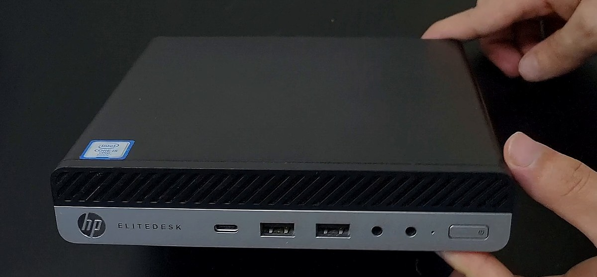
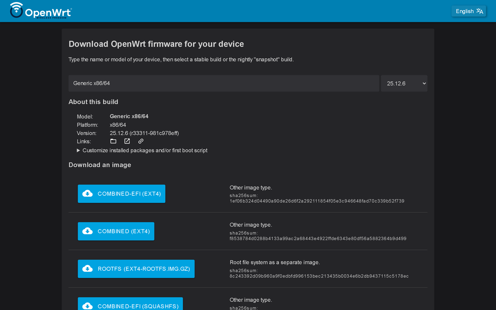
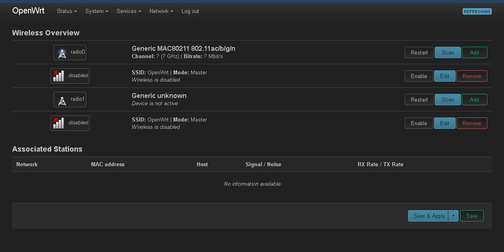
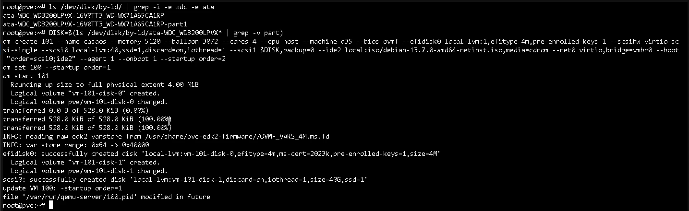
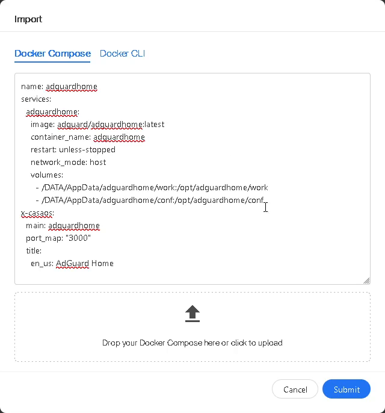
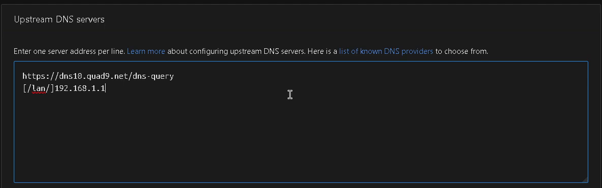
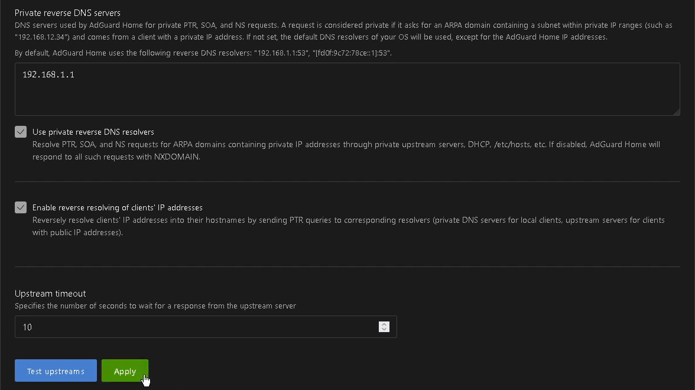
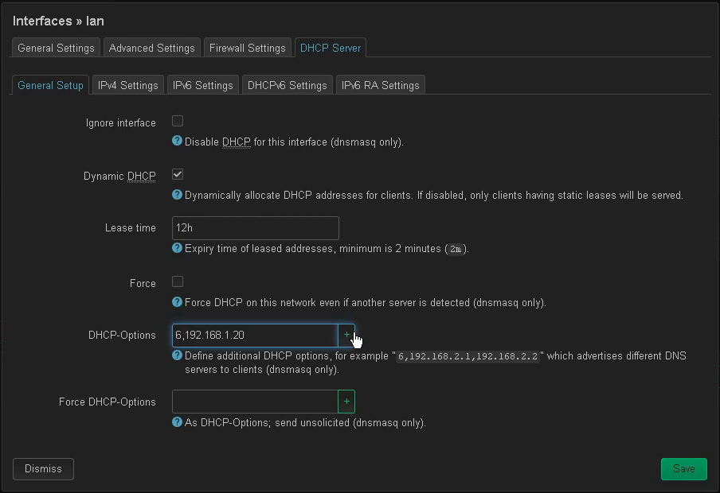
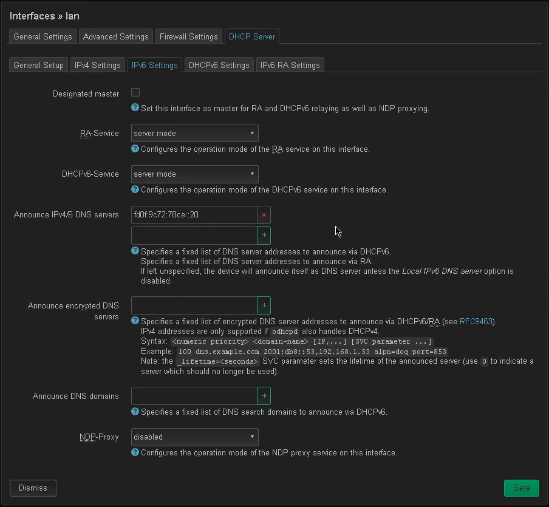
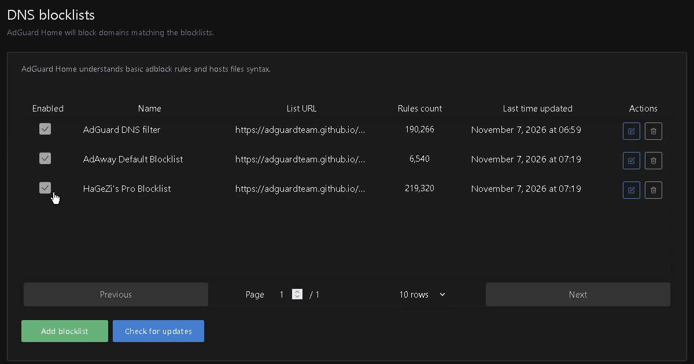

# IP Mini PC

I turned an old office mini PC, an HP EliteDesk 800 G3 Mini, into two computers in one box: a real router with its own
Wi-Fi and dashboard, and a home server that blocks ads for every device on the network and runs Orion, my voice
assistant. Everything runs on free, open source software: Proxmox, OpenWrt, Debian, CasaOS and AdGuard Home.

This repo has every step, command and setting from the video, in the same order.



Orion's voice in the video is Drama 3 by Fish Audio, the sponsor of the video. If you sign up through
[my link](https://fish.audio/?fpr=ipdev) you get 10,000 free credits for the web app (not for the API).

## Contents

- [What you need](#what-you-need)
- [How it works](#how-it-works)
- [1. Flash Proxmox to a USB drive](#1-flash-proxmox-to-a-usb-drive)
- [2. BIOS settings](#2-bios-settings)
- [3. Install Proxmox](#3-install-proxmox)
- [4. The USB Wi-Fi adapter](#4-the-usb-wi-fi-adapter)
- [5. Open Proxmox from your PC](#5-open-proxmox-from-your-pc)
- [6. Build OpenWrt with the Wi-Fi drivers](#6-build-openwrt-with-the-wi-fi-drivers)
- [7. The router VM](#7-the-router-vm)
- [8. First login to the router](#8-first-login-to-the-router)
- [9. Give the USB adapter to the router](#9-give-the-usb-adapter-to-the-router)
- [10. Connect the router to your Wi-Fi](#10-connect-the-router-to-your-wi-fi)
- [11. Your own Wi-Fi (the hotspot)](#11-your-own-wi-fi-the-hotspot)
- [12. SSH on your network only](#12-ssh-on-your-network-only)
- [13. Proxmox updates without a subscription](#13-proxmox-updates-without-a-subscription)
- [14. The Debian VM](#14-the-debian-vm)
- [15. Install Debian](#15-install-debian)
- [16. A fixed IP and a name: casaos.lan](#16-a-fixed-ip-and-a-name-casaoslan)
- [17. CasaOS](#17-casaos)
- [18. AdGuard Home](#18-adguard-home)
- [19. AdGuard DNS settings](#19-adguard-dns-settings)
- [20. Send every device to AdGuard](#20-send-every-device-to-adguard)
- [21. Test it](#21-test-it)
- [22. Blocklists](#22-blocklists)
- [23. Orion Hub](#23-orion-hub)
- [Raspberry Pi 5 vs this mini PC](#raspberry-pi-5-vs-this-mini-pc)
- [Troubleshooting](#troubleshooting)

## What you need

Prices are what I paid in Jordan in November 2026.

| Part | Price | Notes |
|---|---|---|
| HP EliteDesk 800 G3 Mini | 160 JOD (about 225 USD) | used, with its original power adapter. Mine has an Intel Core i5-6500T, 8 GB DDR4 and a 128 GB NVMe SSD. Any mini PC with Intel VT-x and VT-d works the same way |
| USB Wi-Fi adapter | 9 JOD | HAING HI-0600-WUA (Realtek RTL8811CU, "Free Driver"). I later found it online for 3.5 JOD |
| DisplayPort to HDMI adapter | 2 JOD | the HP has no HDMI port. Only needed for the install |
| USB flash drive, 2 GB or more | | for the Proxmox installer. It gets erased |
| Ethernet cable | | from the mini PC to your PC, for the setup |
| 2.5" SATA hard drive (optional) | | for storage. Mine is the WD Blue WD3200LPVX 320 GB from my NAS video |
| USB keyboard and a screen | | only for the BIOS and the Proxmox install |

The HP already has an Intel Wireless 8265 card inside. In this build it becomes the hotspot.

## How it works

```
 your Wi-Fi ))))  USB Wi-Fi adapter
                         |
   HP EliteDesk 800 G3 Mini, running Proxmox (192.168.1.2)
   +---------------------+------------------------------------+
   |  VM 100: OpenWrt    |  VM 101: Debian 13 + CasaOS         |
   |  the router         |  the server (192.168.1.20)          |
   |  192.168.1.1        |  AdGuard Home, Orion Hub, your apps |
   +---------------------+------------------------------------+
                         |
                  Intel 8265 card
                         |
        (((( your own Wi-Fi: phones, laptops, TVs
```

- The USB adapter connects to the Wi-Fi you already have, like a phone would.
- The Intel card inside the HP broadcasts a new Wi-Fi network that you own.
- OpenWrt, the same software many real routers run, sits in between and gives you a router dashboard at 192.168.1.1.
- Every device on your Wi-Fi asks AdGuard Home for its DNS, so ads and trackers are blocked for the whole network.

## 1. Flash Proxmox to a USB drive

1. Download the **Proxmox VE ISO Installer** from [proxmox.com/en/downloads](https://www.proxmox.com/en/downloads). I used Proxmox VE 9.2.
2. Download and open [balenaEtcher](https://etcher.balena.io/).
3. **Flash from file**, pick the ISO, **Select target**, pick your USB drive, then **Flash!**

> [!WARNING]
> Flashing erases the whole USB drive. Move anything you need off it first, or use an empty one.

## 2. BIOS settings

The BIOS key is different on every PC. Search for your model or ask any AI, it will tell you the key. On the HP EliteDesk
800 G3 Mini it is **F10** right after you press the power button (or keep tapping **Esc** and pick BIOS Setup).

1. **Advanced** > **System Options**: turn on **Virtualization Technology (VTx)** and **Virtualization Technology for Directed I/O (VTd)**.
   Leave **M.2 WLAN/BT** checked, that's the Wi-Fi card we need.
2. **Advanced** > **Boot Options**: turn off **Fast Boot**.
3. In the same place, set **After Power Loss** to **Power On**. When the power comes back after a cut, the PC starts by
   itself, so your router never waits for you to press the button.
4. **Main** > **Save Changes and Exit**.

## 3. Install Proxmox

1. Plug in the USB drive, power on and tap the boot menu key (**F9** on the HP). Pick the **UEFI** entry of your USB drive.
   The adapter can show up as a fake "Realtek DISK" drive, don't pick that one.
2. Choose **Install Proxmox VE (Terminal UI)**. The graphical installer has the same steps, pick the one you like.
3. Target disk: the NVMe SSD (not the hard drive).
4. Country, time zone and keyboard layout. Mine: Jordan, Asia/Amman, English (US).
5. The root password and an e-mail. Save the password somewhere safe, it's your Proxmox login.
6. The network page. This part matters, because there is no router yet. We build it inside this same PC in a few steps:

| Field | Value |
|---|---|
| Management interface | the Ethernet port (`nic0`, `e1000e` on the HP). Not the Wi-Fi card |
| Hostname (FQDN) | `pve.home.lan` |
| IP address (CIDR) | `192.168.1.2/24` |
| Gateway | `192.168.1.1` |
| DNS server | `1.1.1.1` |

The gateway is the address of your router: when a device needs something from outside your network (google.com, for
example), it hands the request to the gateway, and the router sends it to the internet and brings the reply back.
`192.168.1.1` is the router we are about to build.

7. **Install**. When it reboots, take the USB drive out. The screen shows `https://192.168.1.2:8006`, and from here on
   you won't need the mini PC's screen or keyboard.

## 4. The USB Wi-Fi adapter

Plug the USB Wi-Fi adapter into the mini PC now and forget it for a while. Each card gets one job:

- **USB adapter:** connects to the Wi-Fi you already have (the internet comes in here).
- **Intel card inside the HP:** the hotspot, your own new Wi-Fi.

## 5. Open Proxmox from your PC

The router doesn't exist yet, so connect your PC straight to the mini PC with an Ethernet cable.

1. On Windows: **Settings** > **Network and internet** > **Advanced network settings** > **More network adapter options**.
2. Right-click **Ethernet** > **Properties** > double-click **Internet Protocol Version 4 (TCP/IPv4)**.
3. **Use the following IP address**:
   - IP address: `192.168.1.10`
   - Subnet mask: `255.255.255.0`
   - leave the gateway and DNS empty, then **OK**.

Or the same thing in one line, in PowerShell as admin:

```powershell
netsh interface ip set address name="Ethernet" static 192.168.1.10 255.255.255.0
```

Your Wi-Fi keeps giving your PC internet the whole time.

4. Open `https://192.168.1.2:8006`. You get a certificate warning, click **Advanced** > **Proceed**.
5. User `root`, the password from the install, realm **Linux PAM standard authentication**.

The "No valid subscription" message is normal. Proxmox is completely free, the subscription is only for paid
enterprise support. Click **OK**. You can hide it with scripts, but every Proxmox update brings it back, so it isn't worth it.

## 6. Build OpenWrt with the Wi-Fi drivers

The plain OpenWrt image has no drivers for our two Wi-Fi cards, and the router has no internet to download them later.
So we build an image with the drivers already inside, on OpenWrt's official website:

1. Open [firmware-selector.openwrt.org](https://firmware-selector.openwrt.org/). I used release **25.12.6**.
2. In the model box type `x86/64` and pick **Generic x86/64**.
3. Click **Customize installed packages and/or first boot script**.
4. Click at the very end of the package list, add a space and paste:

```
kmod-iwlwifi iwlwifi-firmware-iwl8265 kmod-rtw88-8821cu usb-modeswitch wpad-mbedtls luci-app-travelmate
```

| Package | Why |
|---|---|
| `kmod-iwlwifi`, `iwlwifi-firmware-iwl8265` | the Intel 8265 card inside the HP (the hotspot) |
| `kmod-rtw88-8821cu` | the Realtek RTL8811CU / RTL8821CU USB adapter (connects to your Wi-Fi) |
| `usb-modeswitch` | switches "Free Driver" adapters out of their fake CD-drive mode |
| `wpad-mbedtls` | WPA2 for the hotspot and for joining your Wi-Fi |
| `luci-app-travelmate` | optional: joining Wi-Fi networks with a login page (hotels, cafes) |

If your cards are different, swap these drivers for yours.

5. **Request Build**. There is a queue, usually one to three builds ahead of you.
6. When the download buttons show up, download **COMBINED-EFI (EXT4)**, the last one.



7. Rename the file to `openwrt.img` (delete everything after the first dot and type `img`). If Windows hides file
   extensions, turn them on first: File Explorer > **View** > **Show** > **File name extensions**.

## 7. The router VM

1. In Proxmox, open the small arrow next to **pve** > **local (pve)** > **ISO Images** > **Upload** > **Select File** >
   `openwrt.img` > **Upload**. It's done when the log ends with `TASK OK`.
2. Close that window, click **pve** > **Shell** and paste:

```bash
zcat /var/lib/vz/template/iso/openwrt.img > /root/openwrt.raw
printf "vfio\nvfio_iommu_type1\nvfio_pci\n" >> /etc/modules
modprobe vfio_pci
qm create 100 --name openwrt --memory 512 --cores 1 --machine q35 --bios ovmf --efidisk0 local-lvm:1,efitype=4m,pre-enrolled-keys=0 --scsihw virtio-scsi-single --scsi0 local-lvm:0,import-from=/root/openwrt.raw --boot order=scsi0 --net0 virtio,bridge=vmbr0 --hostpci0 0000:01:00.0,pcie=1 --onboot 1
qm start 100
```

This makes VM 100, called `openwrt`, with 512 MB of RAM (OpenWrt is light, it never needs more than half a gig), gives
it the Intel Wi-Fi card, plugs it into the Ethernet side and starts it with the mini PC every time. `trailing garbage
ignored` after the first line is normal for OpenWrt images. When you see `successfully created disk`, it worked, and
`100 (openwrt)` shows up on the left with a green arrow.

> [!NOTE]
> `0000:01:00.0` is where the Intel card sits on my HP. Check yours with `lspci -nn | grep -i network` and use its
> address in `--hostpci0`. The card must be alone in its IOMMU group, see [Troubleshooting](#troubleshooting).

## 8. First login to the router

1. Open `http://192.168.1.1` (http, not https).
2. User `root`, no password. Leave it empty and click **Login**.
3. In the popup click **No**, then **Save & Apply**.
4. The yellow bar says there is no password. Click **Go to password configuration...**, set one and **Save**.

This is the router password, the one for this dashboard. It is not your Wi-Fi password, that comes later. Don't mix them up.

## 9. Give the USB adapter to the router

Go to **Network** > **Wireless**. Only one card shows up, the Intel one inside the PC. The USB adapter is still plugged
into Proxmox, not into the router VM, so we hand it over:

1. In Proxmox: **100 (openwrt)** > **Hardware** > **Add** > **USB Device**.
2. **Use USB Port**, then pick the line that says **Realtek** (mine says "Realtek DISK"). Leave **Use USB3** as it is. **Add**.
3. **Shutdown** at the top right, wait until it stops, then **Start**.

Use the port, not "Use USB Vendor/Device ID": the adapter changes its ID when it leaves CD mode, and the port stays the same.

Back in OpenWrt, refresh **Network** > **Wireless** and log in again. Now there are two radios.



## 10. Connect the router to your Wi-Fi

1. On the **radio1** row (the USB adapter) click **Scan**.
2. Find your Wi-Fi and click **Join Network**.
3. Check **Replace wireless configuration**, type your Wi-Fi password in **WPA passphrase**, leave the name as `wwan`
   and the firewall zone as `wan`. **Submit**.
4. Set **Country Code** to your country. **Save**.
5. **Save & Apply**.

After a few seconds the radio1 line shows signal bars. The router is online.

## 11. Your own Wi-Fi (the hotspot)

On the **radio0** row (the Intel card), the line that says `disabled`, click **Edit**:

| Setting | Value |
|---|---|
| Mode | **N** (change it from AC) |
| Band | **2.4 GHz** (the Intel card can't run a hotspot on 5 GHz) |
| Channel | **6** (on auto it picked 13, which some phones and laptops can't see) |
| Width | 20 MHz |
| Country Code | your country |
| ESSID | your Wi-Fi name, the one your devices will see |
| Network | `lan` |
| Wireless Security > Encryption | **WPA2-PSK** |
| Wireless Security > Key | your Wi-Fi password, at least 8 characters |

Click **Enable**, then **Save**, then **Save & Apply**. Connect your phone to it and open any website.

## 12. SSH on your network only

**System** > **Administration** > **SSH Access**: set **Interface** to `lan`, then **Save & Apply**. Now nobody outside
your own Wi-Fi, or on the main Wi-Fi the router connects to, can even try to SSH into it.

Congratulations, you have a router.

## 13. Proxmox updates without a subscription

Proxmox has internet now, through the router. Point it to the free update source:

1. **pve** > **Updates** > **Repositories**.
2. Select the first line with `enterprise.proxmox.com` (ceph) and click **Disable**. Do the same for the last one
   (`pve-enterprise`). Those are for paying customers.
3. **Add** > **No-Subscription** > **Add**.
4. Optional: **pve** > **Updates** > **Refresh**, then **Upgrade**.

The warning that stays on that page is only information, it doesn't affect anything.

## 14. The Debian VM

This VM is the server: Debian 13 with CasaOS, the same as in my Raspberry Pi NAS video.

1. Open [cdimage.debian.org/debian-cd/current/amd64/iso-cd](https://cdimage.debian.org/debian-cd/current/amd64/iso-cd/),
   right-click the file that ends in `-amd64-netinst.iso` and copy the link.
2. In Proxmox: **local (pve)** > **ISO Images** > **Download from URL**, paste the link, **Query URL**, then **Download**.
3. Find your hard drive's name. In **pve** > **Shell**:

```bash
ls /dev/disk/by-id/ | grep -i -e wdc -e ata
```

4. Paste this (it finds the drive by itself, so there's nothing to type by hand):

```bash
DISK=$(ls /dev/disk/by-id/ata-WDC_WD3200LPVX* | grep -v part)
qm create 101 --name casaos --memory 5120 --balloon 3072 --cores 4 --cpu host --machine q35 --bios ovmf --efidisk0 local-lvm:1,efitype=4m,pre-enrolled-keys=1 --scsihw virtio-scsi-single --scsi0 local-lvm:40,ssd=1,discard=on,iothread=1 --scsi1 $DISK,backup=0 --ide2 local:iso/debian-13.7.0-amd64-netinst.iso,media=cdrom --net0 virtio,bridge=vmbr0 --boot "order=scsi0;ide2" --agent 1 --onboot 1 --startup order=2
qm set 100 --startup order=1
qm start 101
```



Change these to match yours:

- `ata-WDC_WD3200LPVX*`: the start of your drive's name from step 3. No extra drive? Delete `--scsi1 $DISK,backup=0` and the `DISK=` line.
- `debian-13.7.0-amd64-netinst.iso`: the exact name of the ISO you downloaded.
- `--memory 5120`: the RAM in MB. The formula is GB x 1024, so 4 GB is `4096`. I gave it 5 GB to keep some for Proxmox,
  and for a third VM I'll show in a future video.

It makes VM 101, called `casaos`, with 4 cores, a 40 GB system disk on the SSD (out of 128) and the hard drive attached.
`--startup order` makes the router start first, so the internet is up before the server boots.

## 15. Install Debian

Click **101 (casaos)** > **Console** and choose **Install** (the text installer).

| Step | What to pick |
|---|---|
| Hostname | anything, for example `casaos` |
| Domain name | `lan` (it matches the router's local domain) |
| Root password, user, user password | your choice. Write every password down |
| Partitioning | **Guided - use entire disk**, then the **QEMU HARDDISK 42.9 GB**. Not your hard drive! "Entire disk" only means the 40 GB we gave the VM |
| Partitioning scheme | **All files in one partition**, then **Finish partitioning and write changes to disk**, **Yes** |
| Scan extra installation media | **No** |
| Mirror country | yours, or the closest one to you (I picked Turkey), then `deb.debian.org` |
| HTTP proxy | leave it empty |
| Popularity contest | **No** |
| Software selection | uncheck everything except **SSH server** and **standard system utilities** |

No desktop: CasaOS has its own web interface, and we don't want to waste RAM on a desktop nobody uses.
When it finishes, **Continue**.

## 16. A fixed IP and a name: casaos.lan

The VM is already on the router, but its IP can change. So we pin it, and give it a name so you can type `casaos.lan`
instead of an IP.

1. In OpenWrt: **Status** > **Overview**, scroll to **Active DHCPv4 Leases**. The new Linux machine is there.
   To be sure, run `ip a` in the VM's console and compare the IP.
2. Click **Reserve IP** on its line.
3. **Network** > **DHCP and DNS** > **Static Leases** > **Edit** on that entry:
   - **Hostname:** `casaos`
   - **IPv4 address:** `192.168.1.20` (easier to remember than the random one)
4. **Save**, then **Save & Apply**.
5. Reboot the VM (`reboot` in its console, or **Reboot** in Proxmox), then check with `ip a` that it has `192.168.1.20`.

Optional: **Network** > **DHCP and DNS** > **Hostnames** > **Add**, `pve` > `192.168.1.2`, so Proxmox is at
`https://pve.lan:8006`. Switch your PC's Ethernet back to automatic (DHCP) too, now that the router hands out addresses.

## 17. CasaOS

From your PC, connected to your new Wi-Fi:

```bash
ssh your-user@casaos.lan
```

Switch to root (it asks for the root password), then paste:

```bash
su -
```

```bash
apt update && apt install -y curl sudo qemu-guest-agent && systemctl start qemu-guest-agent && usermod -aG sudo "$(id -nu 1000)"
curl -fsSL https://get.casaos.io | bash
```

The first line installs a few packages, the Proxmox guest agent, and adds your user to sudo. The second installs CasaOS
and everything it needs (Docker and the rest) by itself.

When it finishes, open `http://casaos.lan` in a new tab and create your CasaOS account.

## 18. AdGuard Home

AdGuard Home blocks ads and trackers at the DNS level for every device on the network, and does more than that. I
expected to use Pi-hole, but AdGuard Home works almost the same way, it's newer, and its interface is nicer and easier.

You can install it from the CasaOS App Store, or the way I do it:

1. In CasaOS click **+** next to Apps > **Install a customized app**.
2. Click the import arrow at the top, paste this, **Submit**, **OK**, then **Install**:

```yaml
name: adguardhome
services:
  adguardhome:
    image: adguard/adguardhome:latest
    container_name: adguardhome
    restart: unless-stopped
    network_mode: host
    volumes:
      - /DATA/AppData/adguardhome/work:/opt/adguardhome/work
      - /DATA/AppData/adguardhome/conf:/opt/adguardhome/conf
x-casaos:
  main: adguardhome
  port_map: "3000"
  title:
    en_us: AdGuard Home
```

The same file is in [casaos/adguard-home.yml](casaos/adguard-home.yml).



3. Open AdGuard Home from its tile. In the setup:
   - **Admin Web Interface:** All interfaces, port **3000** (not 80, CasaOS already uses 80).
   - **DNS server:** All interfaces, port 53.
   - Leave everything else as it is. **Next**, create a username and password, **Next**, then log in.

## 19. AdGuard DNS settings

**Settings** > **DNS settings**.

**Upstream DNS servers**, put exactly these two lines:

```
https://dns10.quad9.net/dns-query
[/lan/]192.168.1.1
```

The first one is Quad9 over encrypted DNS. The second sends `.lan` names (casaos.lan, pve.lan) to the router, so they
keep working.



**Private reverse DNS servers:** `192.168.1.1`, the router. Keep **Use private reverse DNS resolvers** and **Enable reverse
resolving of clients' IP addresses** checked, so your devices show up by name instead of a bare IP.

**Fallback DNS servers:** `1.1.1.1`

Click **Test upstreams**, then **Apply**.



## 20. Send every device to AdGuard

This is the most important step. The router hands every device the address of its DNS server, so we tell it to hand out
AdGuard's.

In OpenWrt: **Network** > **Interfaces** > **lan** > **Edit** > **DHCP Server**.

1. **General Setup** > **DHCP-Options**, type:

```
6,192.168.1.20
```

`6` means "DNS server", and `192.168.1.20` is the VM running AdGuard. If your VM isn't on `.20`, use its real IP.



2. **IPv6 Settings** > **Announce IPv4/6 DNS servers**: the VM's IPv6 address. Run `ip a` in the VM and copy the one
   that starts with `fd` (mine ends in `::20`), then click **+**. Without this, phones quietly use the router's IPv6 DNS
   and skip AdGuard.



3. **Save**, then **Save & Apply**.

## 21. Test it

Turn your phone's Wi-Fi off and on, open a few websites, then refresh AdGuard's dashboard. Your phone shows up by name in
**Top clients**, and **Blocked by Filters** starts counting. Mine caught `www.google-analytics.com` in the first minute.

## 22. Blocklists

**Filters** > **DNS blocklists** > **Add blocklist** > **Choose from the list**, check **HaGeZi's Pro Blocklist**, then
**Save**. Keep the two that are already there, so all three are checked:

- AdGuard DNS filter
- AdAway Default Blocklist
- HaGeZi's Pro Blocklist



They're all free, maintained by volunteers. Don't stack more lists on top: Pro already covers most of them, and
the more aggressive ones (Pro++, Ultimate) start breaking apps and logins.

That's it, every ad on your network is blocked. One thing to know:

> [!IMPORTANT]
> This doesn't block YouTube ads. They come from the same domains as the videos themselves, so blocking those domains
> blocks YouTube completely.

## 23. Orion Hub

[Orion](https://github.com/MultiX0/orion) is my open source voice assistant. Orion Hub runs on this server, and once
Orion is connected to it, it can run any command you say on the VM, like any other AI agent (Hermes Agent, for example).
All the credit goes to [DeepSeek Harness](https://github.com/deepseek-ai/deepseek-harness), which we use with a few
changes to fit Orion.

Install it on CasaOS the same way as AdGuard: **+** > **Install a customized app** > import, paste
[casaos/orion-hub.yml](casaos/orion-hub.yml), **Submit**, **OK**, **Install**. Put your own Anthropic key in
`ANTHROPIC_API_KEY` first.

```yaml
name: orion-hub
services:
  orion-hub:
    image: multix00/orion-hub:latest
    container_name: orion-hub
    restart: unless-stopped
    network_mode: host
    pid: host
    privileged: true
    environment:
      ANTHROPIC_API_KEY: "paste-your-anthropic-key-here"
      TZ: Asia/Amman
    volumes:
      - /DATA/AppData/orion-hub:/var/lib/orion-hub
      - /var/run/docker.sock:/var/run/docker.sock
x-casaos:
  main: orion-hub
  port_map: "8780"
  icon: https://raw.githubusercontent.com/MultiX0/orion/main/brand/assets/logo.png
  title:
    en_us: Orion Hub
```

Then:

1. Get the Orion app for Windows from [the Orion releases](https://github.com/MultiX0/orion/releases/latest), open it and
   tap **Find my Orion**. It finds the board and gives it your Wi-Fi.
2. Paste your [Fish Audio](https://fish.audio/?fpr=ipdev) API key. That's the voice you hear in the video, Drama 3.
3. Pick the AI you want for the brain. I picked Anthropic, then Claude Sonnet.
4. Connect the app to your hub, and the board connects to them both.

Now you can ask Orion to do things on the server, for example "install Immich on CasaOS". It starts working and tells
you when it's done, and Immich shows up on the dashboard.

How pairing works, the settings, the hub's API and the board itself are in the
[Orion repo](https://github.com/MultiX0/orion) and its [hub README](https://github.com/MultiX0/orion/tree/main/hub).

## Raspberry Pi 5 vs this mini PC

| | Raspberry Pi 5 (4 GB) | HP EliteDesk 800 G3 Mini |
|---|---|---|
| Price (mine, Jordan) | about 130 JOD for the board, 160 to 170 JOD with the official cooler, charger and SD card | 160 JOD with its power adapter, plus 2 JOD for the HDMI adapter |
| CPU | Broadcom BCM2712, 4 cores / 4 threads, 2.4 GHz | Intel Core i5-6500T, 4 cores / 4 threads, 2.5 GHz (3.1 GHz boost) |
| RAM | 4 GB LPDDR4X, soldered | 8 GB DDR4, upgradeable to 32 GB |
| Geekbench 6, single / multi-core | 764 / 1,604 (Raspberry Pi's own average) | about 1,090 / 2,930, so 1.4x and 1.8x faster |
| Power, idle | 3.3 W | about 12 W |
| Power, full load | 9.8 W | about 51 to 59 W |
| 24/7 under heavy load for a month, 200 fils/kWh tier | 1.43 JOD | up to 8.61 JOD |
| Size | fits in your pocket on a power bank | a small box on the desk |

The score is 2 to 2: the mini PC wins on RAM and upgrades, and on CPU speed. The Pi wins on power, and on size. Tell me in
the comments who wins for you.

Sources: [Geekbench 6 results for the i5-6500T](https://browser.geekbench.com/v6/cpu/search?q=i5-6500T) and
[for the Raspberry Pi 5](https://browser.geekbench.com/v6/cpu/search?q=Raspberry+Pi+5+Model+B),
[Raspberry Pi 5 benchmarks](https://www.raspberrypi.com/news/benchmarking-raspberry-pi-5/),
[Jeff Geerling, Pi 5 power](https://www.jeffgeerling.com/blog/2024/new-2gb-pi-5-has-33-smaller-die-30-idle-power-savings/),
[ServeTheHome, EliteDesk 800 G3 Mini](https://www.servethehome.com/hp-elitedesk-800-g3-mini-ce-review-project-tinyminimicro/4/)
and [800 G2 Mini with the same i5-6500T](https://www.servethehome.com/hp-elitedesk-800-g2-mini-project-tinyminimicro-ce-review/3/),
[Jordan's household electricity tariff](https://jordannews.jo/Section-109/News/Over-90-of-Jordanians-will-not-be-affected-by-the-new-electricity-tariff-11865).
These are other people's measurements, so your numbers will be a bit different.

## Troubleshooting

**The screen stays black after the Proxmox install.** Unplug and replug the HDMI adapter, or open
`https://192.168.1.2:8006` from your PC. If neither works, hold the power button for 5 seconds, make sure the USB drive is
out, power on, press F9 and pick the NVMe entry.

**Is VT-d really on?** In **pve** > **Shell**:

```bash
dmesg | grep -e DMAR -e IOMMU | head -20
for d in /sys/kernel/iommu_groups/*/devices/*; do n=${d#*/iommu_groups/}; n=${n%%/*}; printf 'Group %s: ' "$n"; lspci -nns "${d##*/}"; done | grep -i -e network -e wireless -e ethernet
```

The first should mention "Intel(R) Virtualization Technology for Directed I/O". In the second, the Wi-Fi card should be
alone in its group: `ls /sys/kernel/iommu_groups/<group>/devices/` should print only its address.

**The USB adapter shows up as a CD drive.** That's the "Free Driver" mode with the Windows driver on it. The
`usb-modeswitch` package in the OpenWrt image switches it. In Proxmox, pass it by **USB Port**, not by ID.

**Immich (or any app) on the hard drive.** Set the storage folder on the hard drive before the app's first start: in
CasaOS **Files**, make a folder on the drive, then install the app with the custom install settings and point its upload
volume there. If you change it after the app has already started once, Immich refuses to start because its files are
missing from the new folder.

## Links

- YouTube: [Introvert Programmer](https://www.youtube.com/@introvert_programmer)
- Instagram: [@iprogyt](https://instagram.com/iprogyt)
- My NAS video repo (Raspberry Pi 5 + CasaOS): [MultiX0/ip-nas](https://github.com/MultiX0/ip-nas)
- Orion: [MultiX0/orion](https://github.com/MultiX0/orion)
- Fish Audio, the voice of Orion: [fish.audio](https://fish.audio/?fpr=ipdev)
- Support the channel: [PayPal](https://www.paypal.me/multix1)
- Business: ads@iprog.dev

## License

MIT, see [LICENSE](LICENSE). Proxmox, OpenWrt, Debian, CasaOS, AdGuard and the other names here belong to their owners.
Everything here is provided as is, without warranty. A router is the door of your network, so keep its passwords strong.
